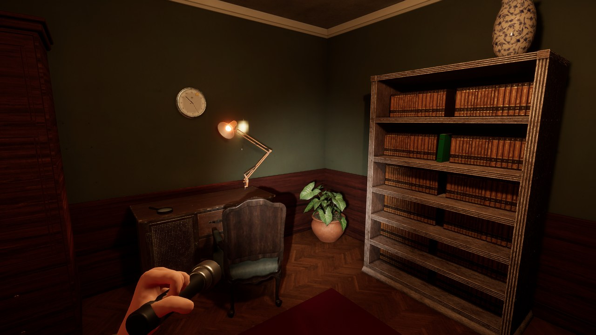
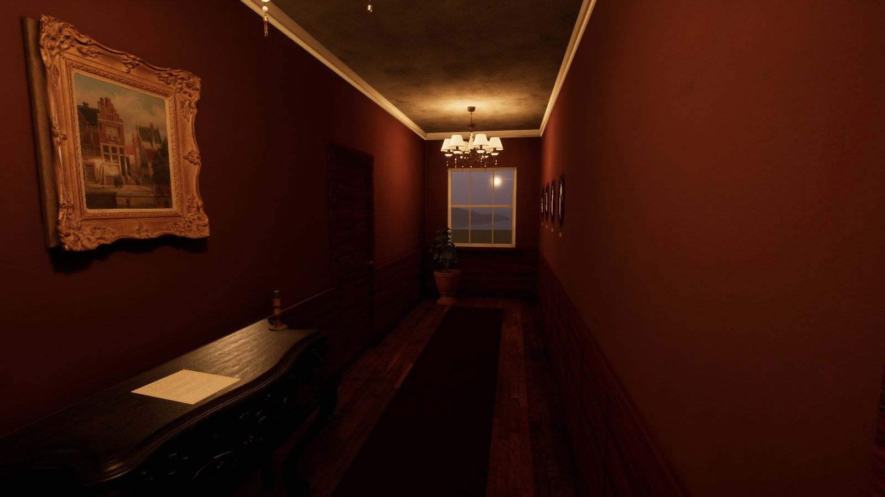
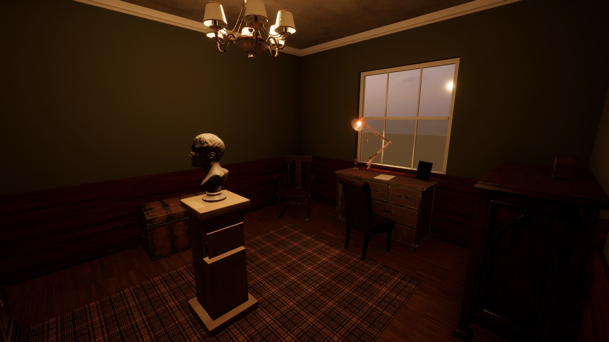

# Escape Room

A photorealistic first-person escape room. Dusk is falling, the lamps are on, and you're locked inside an old family house. Search every drawer, read every note, piece the clues together, and find your way out the front door.

## Download

**[⬇ Download the latest version](../../releases/latest)**

| Platform | File |
|---|---|
| Windows (64-bit) | `EscapeRoom-Windows.zip` |
| macOS | `EscapeRoom-Mac.zip` |
| Linux (may also work on high-end Chromebooks) | `EscapeRoom-Linux.zip` |

Each download is about 800 MB.

## How to start it

**Windows:** unzip, then double-click `Escape Room.exe`. If Windows SmartScreen says it "protected your PC", click **More info → Run anyway** (the game isn't signed by a publisher).

**macOS:** unzip, then **right-click `Escape Room.app` → Open** and confirm the first time (the app isn't signed by Apple). After that it opens normally. Runs best on Apple Silicon Macs.

**Linux:** unzip, then run `./EscapeRoom.x86_64`. Needs working Vulkan graphics drivers.

**Chromebook (experimental):** only on higher-end Chromebooks with an Intel or AMD processor.
1. Turn on Linux: *Settings → About ChromeOS → Developers → Linux development environment*.
2. Move `EscapeRoom-Linux.zip` into **Linux files**.
3. In the Terminal app: `unzip EscapeRoom-Linux.zip -d EscapeRoom && cd EscapeRoom && ./EscapeRoom.x86_64`

Many Chromebooks don't have the graphics power for this game, and ARM-based Chromebooks can't run it at all.

## Controls

| Key | Action |
|---|---|
| W A S D / arrow keys | Walk |
| Mouse | Look around |
| Shift | Walk faster |
| Space | Jump |
| E / left click | Use, open, pick up |
| F | Torch (flashlight) on / off |
| Tab | Inventory |
| H | Ask for a hint |
| Esc | Settings (volume, restart, quit) |

While holding something: move the mouse to turn it, **F** to flip it over, **R** to read or use it.

## Screenshots

## System requirements

- A reasonably modern computer with a dedicated graphics card or recent integrated graphics. The game uses Unity's high-definition renderer.
- It runs at about 40 fps on a laptop with AMD Radeon 780M graphics.
- 3 GB of free disk space.

## Credits

- 3D models, textures and skies: [Poly Haven](https://polyhaven.com) (CC0)
- Sound effects: [Freesound.org](https://freesound.org) contributors (CC0). The full list is in `CREDITS.txt` inside each download.
- Made with Unity.
